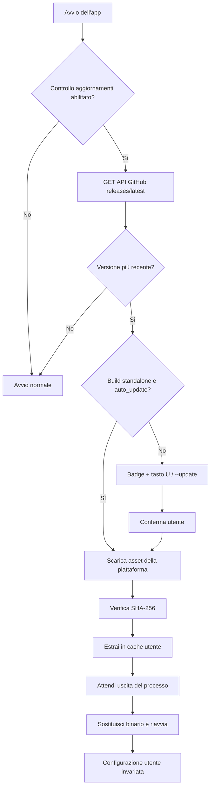

# Piano multipiattaforma: macOS, Linux e aggiornamenti

Questo documento descrive lo stato attuale e il piano per distribuire ModelsCompare su macOS e Linux con lo stesso livello di qualità di Windows, inclusi aggiornamenti automatici e conservazione dei dati utente.

## Obiettivi

1. Un solo codice Python per Windows, macOS e Linux.
2. Release GitHub con binari standalone, checksum e note generate automaticamente.
3. Aggiornamento automatico sicuro per le build standalone, senza toccare preferiti, filtri ed export.
4. Interfaccia leggibile su terminali di dimensioni diverse e con caratteri Unicode.
5. Test automatici su tutti e tre i sistemi prima di pubblicare.

## Stato attuale

- [x] Codice unico con `prompt_toolkit` e `rich`.
- [x] Percorsi di configurazione XDG/APPDATA, Downloads XDG e cache aggiornamenti per piattaforma.
- [x] Layout responsive con larghezza calcolata, troncamento per display width e modalità compatta.
- [x] Ricerca, aiuto contestuale, toggle USD/crediti e indicatore di posizione.
- [x] Controllo aggiornamenti GitHub, badge, tasto `U`, comandi `--check-updates` e `--update`.
- [x] Download atomico, verifica SHA-256, estrazione sicura e sostituzione del binario dopo l'uscita.
- [x] Export CSV/Excel validato, sanitizzato e scritto senza sovrascrivere file esistenti.
- [x] Workflow GitHub Actions con test su Windows/macOS/Linux e build native per Windows x64, Linux x64/arm64, macOS arm64/Intel.
- [x] Script unico `scripts/build_release.py` per creare archivi e checksum su tutte le piattaforme.
- [ ] Firma del codice Windows e notarizzazione macOS (richiede certificati e account a pagamento).
- [ ] Pacchetto Homebrew e repository APT/PPA (opzionali, dopo la prima release multipiattaforma).
- [ ] Test manuali su terminali reali (vedi matrice sotto).

## Matrice terminali

| Terminale | Sistema | Note |
| --- | --- | --- |
| Windows Terminal | Windows 10/11 | Consigliato; supporta UTF-8, colori e Unicode largo. |
| PowerShell 7 | Windows | Funziona; preferire Windows Terminal per i caratteri larghi. |
| Terminal.app | macOS | Supporta UTF-8; testare emoji e box drawing. |
| iTerm2 | macOS | Consigliato; true color e Unicode completi. |
| GNOME Terminal / Konsole | Linux | Supporto UTF-8 e true color. |
| tmux / screen | macOS/Linux | Verificare `TERM` e `LANG`; usare `tmux -u` se necessario. |
| Terminali senza UTF-8 | tutti | L'app resta utilizzabile; i bordi e le emoji possono apparire come caratteri sostitutivi. |

### Requisiti consigliati

- Locale UTF-8: `LANG=it_IT.UTF-8` o `en_US.UTF-8` su macOS/Linux.
- `TERM=xterm-256color` per i colori.
- Almeno 80 colonne per la vista compatta; 112+ per tutte le colonne.
- Almeno 24 righe per banner, tabella, scheda, aiuto e footer.

## Strategia di distribuzione

### Windows

- `ModelsCompare.exe` standalone (PyInstaller, modalità console).
- ZIP portatile con README.
- Aggiornamento automatico tramite script batch che attende l'uscita del processo e sostituisce l'EXE.

### macOS

- Binario CLI standalone in `modelscompare-macos-<arch>.tar.gz`.
- Architetture: `arm64` (Apple Silicon) e `x64` (Intel).
- Aggiornamento automatico tramite script POSIX che attende il PID, copia il nuovo binario e lo riavvia.
- In futuro: bundle `.app` firmato e notarizzato, oppure pacchetto Homebrew.

### Linux

- Binario CLI standalone in `modelscompare-linux-<arch>.tar.gz`.
- Architetture: `x64` e `arm64`.
- Aggiornamento automatico con lo stesso script POSIX di macOS.
- In futuro: pacchetto `.deb`/`.rpm`, Flatpak o repository APT.

### Installazioni da sorgente

- `pip install .`, `pipx install .` e `python -m modelscompare` restano supportati.
- L'auto-aggiornamento non modifica l'ambiente Python: mostra il comando `pip`/`pipx` corretto.
- Ideale per sviluppatori e utenti avanzati che preferiscono gestire le dipendenze.

## Flusso di aggiornamento



### Dati utente

I dati non sono mai dentro la cartella di installazione:

- Windows: `%APPDATA%\modelscompare\config.json`
- macOS: `~/.config/modelscompare/config.json`
- Linux: `$XDG_CONFIG_HOME/modelscompare/config.json` o `~/.config/modelscompare/config.json`

L'updater sostituisce solo il binario. Preferiti, filtri, unità, formati di export e profili alternativi restano intatti.

### Sicurezza

- Download solo HTTPS dall'API GitHub.
- Limite di dimensione del pacchetto.
- Verifica SHA-256 dal campo `digest` dell'API o dal file `.sha256` pubblicato.
- Estrazione con controllo dei percorsi per evitare path traversal e link simbolici.
- Nessuna esecuzione di codice scaricato: viene eseguito solo il binario aggiornato.
- Se la cartella dell'eseguibile non è scrivibile, l'app non forza la sostituzione e mostra il link alla release.

## CI/CD

Il workflow `.github/workflows/release.yml`:

1. Esegue `pytest` su Windows, macOS e Linux con Python 3.10 e 3.13.
2. Su tag `v*`, compila con PyInstaller su tutti e tre i sistemi.
3. Carica archivi e checksum.
4. Crea o aggiorna la release GitHub con note generate automaticamente.

Asset prodotti:

```text
ModelsCompare.exe
modelscompare-windows-x64.zip
modelscompare-linux-x64.tar.gz
modelscompare-linux-arm64.tar.gz
modelscompare-macos-arm64.tar.gz
modelscompare-macos-x64.tar.gz
*.sha256
```

## Fasi successive

### Fase 1 — Consolidamento (breve termine)

- Test manuali su Windows Terminal, Terminal.app, iTerm2, GNOME Terminal e tmux.
- Verificare l'auto-aggiornamento su una release di prova.
- Controllare che un aggiornamento non perda i preferiti.
- Aggiungere screenshot/GIF al README.

### Fase 2 — Distribuzione nativa

- Windows: firma Authenticode e manifest winget aggiornato alla nuova versione.
- macOS: bundle `.app`, firma Developer ID e notarizzazione, oppure formula Homebrew.
- Linux: pacchetto `.deb` e `.rpm`, eventualmente Flatpak.
- Pubblicare checksum e note di rilascio in modo stabile.

### Fase 3 — Esperienza utente

- Tema chiaro/scuro automatico in base al terminale.
- Filtri interattivi per provider/categoria oltre alla ricerca libera.
- Ordinamento ciclico con un tasto (senza riavviare l'app).
- Confronto affiancato di due modelli con evidenza del risparmio per singola voce di costo.
- Documentazione con GIF delle scorciatoie.

## Rischi e mitigazioni

| Rischio | Mitigazione |
| --- | --- |
| Binari non firmati bloccati da Gatekeeper/SmartScreen | Istruzioni chiare, checksum, firma/notarizzazione in Fase 2. |
| Aggiornamento mentre il file è in uso | Script che attende la chiusura del processo prima di sostituire. |
| Cartella di installazione non scrivibile | Nessuna sostituzione forzata; link alla release e istruzioni manuali. |
| Terminale senza UTF-8 | Layout compatto e caratteri ASCII nei casi stretti; documentazione locale. |
| GitHub API rate limit | Controllo con timeout breve e fallback silenzioso; il tasto `U` riprova. |
| Release senza asset per la piattaforma | Messaggio esplicito e nessuna installazione parziale. |
| Perdita dei dati utente | Configurazione separata dal binario e test di regressione. |
| Excel corrotto | Validazione con `openpyxl`, sanitizzazione XML e scrittura atomica. |

## Test manuali consigliati

1. Avvio con terminale 80×24: nessuna riga tagliata, footer leggibile.
2. Avvio con terminale 120×40: tutte le colonne cached visibili.
3. Ricerca, toggle unità, aiuto, confronto e ritorno alla lista.
4. Export CSV ed Excel; apertura in Excel/LibreOffice e verifica dei quattro costi.
5. Export con file già presenti: suffissi `_1`, `_2` senza sovrascritture.
6. Aggiornamento da una release precedente: preferiti e configurazione invariati.
7. Avvio offline: messaggio di errore chiaro, nessun crash e nessun file parziale.
8. macOS ARM64 e Intel; Linux x64 e ARM64 se disponibili.
